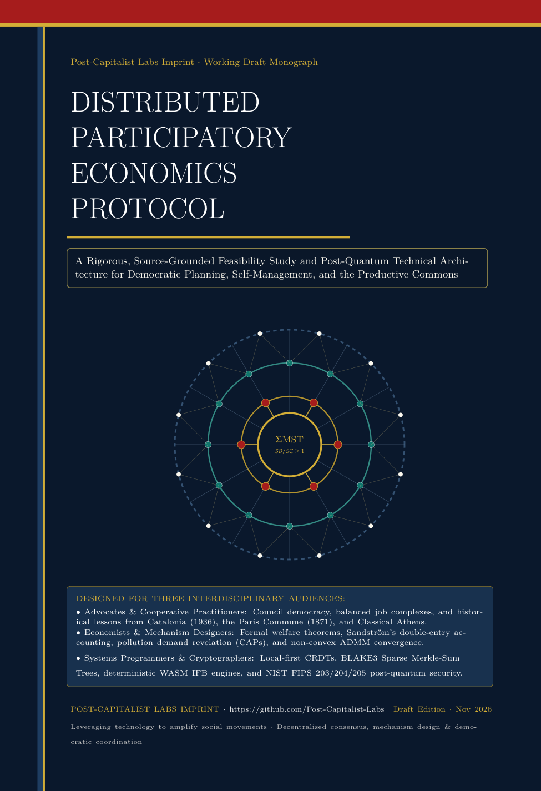

# Distributed Participatory Economics Protocol (DPEP)

> **Status: Working Draft Monograph (November 2026)**  
> **Published under the [Post-Capitalist Labs](https://github.com/Post-Capitalist-Labs) Imprint** · Maintained by **[Titan Cassini](https://github.com/titancassini)**

---

## 📖 Read the Book (Working Draft)

- **[Download the Typeset PDF Monograph (`Distributed_Participatory_Economics_Protocol_Book.pdf`)](./Distributed_Participatory_Economics_Protocol_Book.pdf)** *(133 pages, LaTeX typeset with full mathematical models, comprehensive list of abbreviations & notation, canonical CBOR/`proto3` schemas, architecture diagrams, 6-discipline critical review, scientific claims register, and source footnotes)*
- **LaTeX Source:** [`book/dpep_book.tex`](./book/dpep_book.tex)

*Note: This research monograph and technical architecture specification are currently released in **draft form** for open community review, critique, and collaborative iteration prior to Proof-of-Concept implementation.*

---

## About the Book

Can contemporary distributed computing, post-quantum cryptography, local-first software, and mathematical optimization provide the technical foundations for a democratic, classless, ecologically sustainable post-capitalist economy?

This book presents a rigorous, source-grounded feasibility study and systems architecture proposal for the **Distributed Participatory Economics Protocol (DPEP)**. Grounded in the economic model of **Participatory Economics (Parecon)** developed by Michael Albert and Robin Hahnel (*The Political Economy of Participatory Economics*, 1991; *Looking Forward*, 1991; *Parecon: Life After Capitalism*, 2003; *Democratic Economic Planning*, 2021), Anders Sandström's double-entry social accounting (*Anarchist Accounting*, 2020), and historical experiences of democratic self-management (the 1936–1939 Spanish Revolution, the 1871 Paris Commune, Classical Athens, Occupy, and Mondragón), the book is written for three interdisciplinary audiences:

1. **Advocates & Cooperative Practitioners:** How council democracy, balanced job complexes, revocable delegation, sortition, and productive-commons accounting prevent bureaucratic capture, meeting fatigue, and inter-regional inequality.
2. **Economists & Mechanism Designers:** Formal mathematical integration of Albert and Hahnel's Formal Model of a Participatory Economy (FMPE) with Sandström's *Society Account* and Hahnel's Pollution Demand-Revealing Mechanism (PDRM); a source-code audit of the `pequod-cljs` planning simulator; and **Algorithm 3** (Safeguarded Primal-Dual / ADMM Proximal Regularization) for convergence under non-convexities and hard biophysical ecological caps.
3. **Systems Programmers & Cryptographers:** Why participatory planning is an epoch-synchronized bulk-synchronous aggregation process rather than a high-TPS global blockchain problem—specifying **Architecture D** (Local-First SQLite/CRDT council workspaces + QUIC P2P transport + **BLAKE3 Sparse Merkle-Sum Trees** + deterministic fixed-point **`Wasmtime` IFB engines** + **NIST FIPS 203/204/205 post-quantum security** + `Prio3` VDAF private household aggregation + crypto-agile interim credentials and beacon, with a component-by-component maturity assessment).

---

## Repository Structure

| Path | Description |
| :--- | :--- |
| **[`Distributed_Participatory_Economics_Protocol_Book.pdf`](./Distributed_Participatory_Economics_Protocol_Book.pdf)** | **Complete 133-page typeset PDF book (Working Draft)** published under the Post-Capitalist Labs Imprint. |
| [`reports/EXECUTIVE_SUMMARY.md`](./reports/EXECUTIVE_SUMMARY.md) | Standalone executive summary covering feasibility, architecture, obstacles, PoC scope, and budget scenarios. |
| [`reports/HISTORICAL_INSTITUTIONS.md`](./reports/HISTORICAL_INSTITUTIONS.md) | Institutional analysis of Spain (1936), Paris Commune (1871), Classical Athens, Occupy, Mondragón, Porto Alegre, Rojava, and Ostrom's CPR principles. (The book's Chapter 2 now also covers Russia 1917–21, Hungary 1956 and Castoriadis, Yugoslavia, Chile, Argentina 2001, the Zapatistas, and the 2010–11 uprisings and Sudan.) |
| [`reports/ECONOMIC_MODEL.md`](./reports/ECONOMIC_MODEL.md) | Formal mathematical specification, Sandström's Society Account, 10-state machine, convergence algorithms, and `proto3` schemas. |
| [`reports/TECHNICAL_ARCHITECTURE.md`](./reports/TECHNICAL_ARCHITECTURE.md) | Four-layer hybrid local-first + federated Merkle-Sum Tree + selective Epoch-BFT architecture and 6-role mobile/low-power taxonomy. |
| [`reports/TECHNOLOGY_COMPARISON.md`](./reports/TECHNOLOGY_COMPARISON.md) | Weighted 14-criterion comparison of Architectures A, B, C, and D, candidate P2P/consensus/ZK technologies, and language stacks. |
| [`reports/SECURITY_AND_PQC.md`](./reports/SECURITY_AND_PQC.md) | NIST FIPS 203/204/205 post-quantum cryptography benchmarks, non-plutocratic Sybil resistance, 14-vector threat model, and privacy architecture. |
| [`reports/STACK_MATURITY.md`](./reports/STACK_MATURITY.md) | Maturity dossier for every stack component (primitive, named implementation, DPEP composition): standards status, production users, cryptographers, audits, gaps. Machine-readable register: [`research/stack_maturity_register.csv`](./research/stack_maturity_register.csv). |
| [`reports/AI_AND_OPTIMISATION.md`](./reports/AI_AND_OPTIMISATION.md) | Deterministic operations research core (`Clarabel.rs` / `HiGHS`) vs. bounded edge AI, plus analysis of 20 economic and institutional failure modes. |
| [`reports/POC_SPECIFICATION.md`](./reports/POC_SPECIFICATION.md) | Implementable 1,000-participant Proof-of-Concept specification, multi-scale benchmark programme ($10^2$ to $10^6$), and roadmap. |
| [`reports/OPEN_QUESTIONS.md`](./reports/OPEN_QUESTIONS.md) | Ranked research agenda of 15 open theoretical, institutional, economic, and technical questions. |
| [`research/`](./research/) | Source provenance manifest ([`research/sources/MANIFEST.md`](./research/sources/MANIFEST.md)), traceability requirements ([`research/participatory-economics-requirements.md`](./research/participatory-economics-requirements.md)), and verified bibliography ([`research/bibliography.md`](./research/bibliography.md)). |
| [`book/dpep_book.tex`](./book/dpep_book.tex) | Complete LaTeX book manuscript (compiles reproducibly via `tectonic -X compile book/dpep_book.tex`). |

---

## About Post-Capitalist Labs

**[Post-Capitalist Labs (PCL)](https://github.com/Post-Capitalist-Labs)** harnesses the transformative power of technology to bolster social movements and build directly democratic alternatives to capitalism. We envisage a world where solidarity, care, classlessness, diversity, self-reflection, and direct democracy are the foundations of everyday life. Through historical analysis, emancipatory economic modeling, mechanism design, and open-source protocol engineering, PCL develops practical tools where people remain in control.

- **Organization GitHub:** [https://github.com/Post-Capitalist-Labs](https://github.com/Post-Capitalist-Labs)
- **Author / Maintainer Profile:** [https://github.com/titancassini](https://github.com/titancassini)
